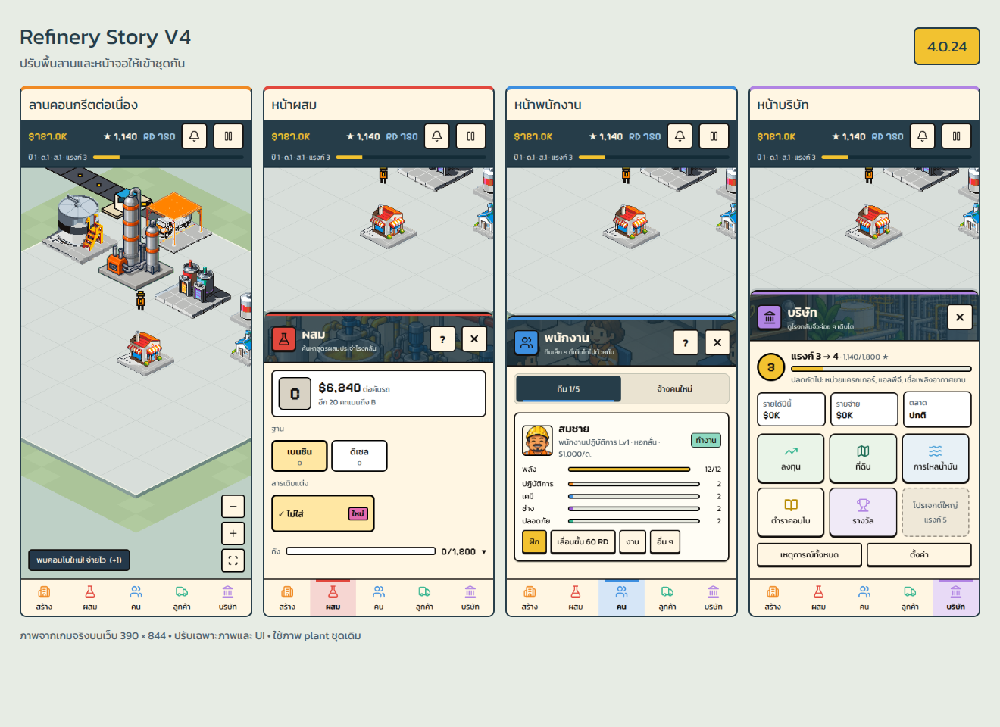

# UI surfaces and shared yard — 4.0.24

Branch: `rewrite/v4`. Base: `bdefe09` (4.0.23). Android versionCode: 36.

Scope: presentation only. The owner asked to work on other screens and the gameplay yard background before returning to plant art.

## Result

- Owned parcels render as one light grey concrete yard. Subtle expansion joints are spaced every two tiles; placement shows the existing one-tile grid more clearly.
- Flush curbs and three-pixel near-edge thickness appear only at the perimeter. Adjacent owned parcels share a continuous floor; purchasing land extends the same surface.
- Low-contrast grass surrounds the concrete and the public gate approach road keeps its existing coordinates.
- Shared illustrated panel headers have a category badge, short localized caption and consistent close/help buttons. Staff and customer tabs share a readable selected state.
- Build cards have quiet preview wells; company menu tiles use restrained category tints. The Thai market value uses Kanit rather than the number font.
- The title keeps the existing full-screen artwork and adds a cream menu frame. Bottom tabs have a small active-color marker.
- Help and panel tabs expose explicit ARIA state on web alongside native accessibility state.

## Protected behavior

No changes to `src/v4/sim/**`, `src/v4/data/**`, `scripts/v4/**`, existing plant/vehicle/worker assets, sprite registries, camera math, hit testing, `canPlace`, economy, recipes, progression, saves or existing dispatch actions.

`yardGround.ts` is a render-only command builder. It reads owned parcels and draws at the existing 32×16 tile coordinates. The placement flag affects line color/density only. Ground is cached until parcels, the gate or placement mode change.

## Verification

- `npm run format`, `npx tsc --noEmit`, `npm run v4:check`, web export and `git diff --check`.
- Full `v4:check` output matches the pre-change output byte for byte, including the 20-seed simulation. Protected directories have an empty diff.
- Actual exported Expo app in Chromium/CanvasKit at 390×844, plus the staff screen at 360×740; isolated local browser saves only.
- Title, yard, Build, Blend, Staff, Customers and Company visually inspected; no page horizontal overflow or browser exceptions.
- Cancel placement leaves funds unchanged; a product tank charges the existing $5,000. Buying an adjacent parcel charges the existing $20,000.
- Help opens/closes; staff hiring and customer market/regular tabs switch; closing sheets and placement controls remain available.
- Land expansion shows the same continuous concrete surface and placement uses the exact existing grid.

The screenshots use a paused illustrative save with extra funds, rank 3 and several buildings. No fixture or debug affordance is included in the app. This is browser verification; Android device performance and touch feel remain unverified locally. APK compilation uses the existing push workflow.

## Preview

Other screenshots: [title](previews/ui-surfaces-4.0.24/title.png), [Build](previews/ui-surfaces-4.0.24/build.png), [Customers](previews/ui-surfaces-4.0.24/customers.png), [placement](previews/ui-surfaces-4.0.24/placement.png), [expanded land](previews/ui-surfaces-4.0.24/expanded-yard.png).
